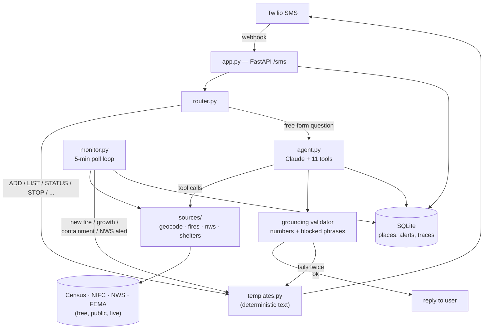

# FireBuddy

FireBuddy is an SMS wildfire assistant: text it an address and it watches that
place for active fires and official alerts, texts you first when something
changes, and answers plain-language questions like "should I leave?", "is the
wind pointing my way?", or "find me a shelter." It's built to demonstrate
FDE-grade agentic engineering — a Claude tool-using agent given real autonomy
over a safety-relevant domain, but with every decision that actually matters
(whether to alert, what guidance level to give, what an official order said)
locked to deterministic code and a runtime grounding validator, never to the
LLM's judgment. See [`PLAN.md`](PLAN.md) for the full design and
[`STATUS.md`](STATUS.md) for build history, live verification, and what's
still blocked.

## Architecture



The agent never decides *whether* to send a proactive alert, *what level* of
urgency to give, or *what* an official order says — `monitor.py`'s triggers,
`assess.py`'s deterministic guidance table, and verbatim-quoted NWS text own
those calls. The agent's only job is explaining facts that tools already
returned, and a validator checks every reply before it ships.

## Safety-first design

| Decision | Owned by | Rule |
|---|---|---|
| Whether to send a proactive alert | `monitor.py` (deterministic) | Never the LLM |
| Alert wording | `templates.py` (fixed templates) | No LLM in the alert path |
| "Should I leave?" guidance level | `assess.py` (deterministic rules) | The LLM may **escalate** the wording, never **de-escalate** it |
| Wind relative to a fire | `assess.py` (deterministic math) | The LLM explains the result, doesn't compute it |
| Official orders and alerts | Quoted word for word | Never paraphrased |
| Evacuation routes | Not generated | Quotes official text if it names a route; otherwise points to official sources |
| Watches, conversation, follow-ups | The Claude agent (tool use) | The one place the LLM has real autonomy |
| Safety claims ("you're safe", "no need to leave") | Never said | Except quoting an official shelter-in-place order verbatim |

Every agent reply is checked by a **grounding validator** before it's sent:
every number in the reply (other than clock times) must trace back to a tool
result or the user's own message, and a short list of blocked phrases (unquoted
safety claims, generated route instructions) is allowed only when it appears
verbatim in a tool result. A reply that fails gets one retry; if it fails
again, the agent falls back to a deterministic status template rather than
sending anything ungrounded. Every turn — input, tool calls, final text,
validator verdict, retries, latency, token usage — is written to `agent_traces`
and inspectable via `python -m firebuddy.traces --last 20`.

## Live results

The agent and the eval suite have both been run against the real model
(`claude-sonnet-5-5`), not just against fixtures and a fake client:

- **Eval suite: 10/10 scenarios passed, 0 ungrounded or failed-validator turns**
  across 11 agent turns — covering MONITOR-level calm, GET-READY escalation,
  verbatim evacuation orders, shelter-in-place (never "leave"), no-generated-routes,
  no-safety-claims, no-open-shelters fallback, stale-wind flagging, adding a
  second watched place with a scheduled follow-up, and escalating wording when
  a user reports seeing flames.
- **Cost: $0.3352 total** for that full verification pass (eval suite +
  five hand-run conversation scenarios in the simulator) — 116,768 input and
  10,169 output tokens at `claude-sonnet-5-5`'s $2 / $10 per-million-token rate.
- **157 unit/integration tests, all offline** — fixtures and a scripted fake
  LLM client stand in for live APIs and Claude, so the suite never costs money
  or depends on network access. `ruff` clean.
- **Live-verified against real data**: Census geocoding, NIFC active-fire
  incidents, NWS alerts and wind observations, and FEMA shelter listings all
  confirmed against the real APIs for a Danville, CA address.

Full numbers, scenario-by-scenario detail, and the two real bugs this caught
(an extended-thinking content block the agent loop didn't handle, and a
fixture that collapsed two addresses onto one point) are in `STATUS.md`.

## Demo: the console simulator

The fastest way to see the whole system work end to end, fully offline (fires,
NWS alerts, wind, shelters, and geocoding are all fixture-backed inside the
simulator — see `fixtures/`):

```bash
PYTHONPATH=. python sim.py
```

Chat as the simulated user, or use `:` commands to control the simulated world.
Any address you type resolves to the same fixture location (Danville, CA) —
that's the point, it's deterministic and offline. Try:

```
hi
3301 Camino Tassajara, Danville, CA
ADD 500 Diablo Rd, Danville, CA
LIST
STATUS
:fire Morgan 40 9 E
:wind 90 14 25
:nws redflag Red Flag Warning issued for Contra Costa County
:tick
:tick
:grow Morgan 150
:tick
:contain Morgan 100
:tick
:shelter Monte Vista HS Gym open
STATUS
:advance 3
STOP
LIST
START
HELP
:quit
```

The second `:tick` after setting up the fire sends nothing new — that's the
dedupe (`sent_alerts`) working. Type `:help` inside the simulator for the full
command list. If `ANTHROPIC_API_KEY` is set, free-form questions ("should I
leave?", "is the wind pointing my way?") go to the real agent; without it,
they get a canned fallback that points back at the deterministic commands.

## Setup

```bash
python3.11 -m venv .venv
source .venv/bin/activate
pip install -r requirements.txt
cp .env.example .env
```

Fill in `.env` as you get keys. With nothing filled in, everything above
still runs: data sources (geocoding, fires, NWS, shelters) are free and need
no key; the agent and real SMS are the only two pieces that need credentials.

## Tests and lint

```bash
pytest
ruff check .
```

## Run the real app

```bash
uvicorn firebuddy.app:app --reload
```

- `GET /health` — liveness check.
- `POST /sms` — Twilio webhook. Verifies the Twilio signature unless `DRY_RUN=true`.
- A background task runs the monitor loop every `MONITOR_INTERVAL_SEC` seconds.

### SMS: pending carrier registration

The webhook, router, onboarding, and the full conversation flow are built and
tested end to end against a console/dry-run SMS backend (see `sim.py` above).
What's not live is a real text round-tripping through Twilio to a phone: a
Twilio trial number can only text pre-verified numbers, and sending to
arbitrary numbers requires **A2P 10DLC carrier registration**, which takes
Twilio/the carriers on the order of weeks and is currently pending. Until
that clears, `DRY_RUN=true` (the default) prints outbound messages to the
console instead of sending — safe by default. Once registration clears, going
live is: set `TWILIO_ACCOUNT_SID`/`TWILIO_AUTH_TOKEN`/`TWILIO_FROM_NUMBER`,
run `ngrok http 8000` and point the Twilio number's webhook at
`<PUBLIC_BASE_URL>/sms`, add your own number to `SMS_ALLOWLIST`, and set
`DRY_RUN=false`.

## Running real agent conversations

Set `ANTHROPIC_API_KEY` (and optionally `ANTHROPIC_MODEL`, default
`claude-sonnet-5-5`) in `.env`. Then both `sim.py` and the `/sms` webhook route
free-form questions to the real model. Every agent turn is logged; inspect them with:

```bash
PYTHONPATH=. python -m firebuddy.traces --last 20
```

## Evals

```bash
PYTHONPATH=. python -m evals.run_evals
```

Runs the 10 scenarios in `evals/scenarios.py` against the real model (requires
`ANTHROPIC_API_KEY`), capped at `EVAL_MAX_TURNS` total agent turns and reporting
total token usage and cost. Without a key it prints `BLOCKED` and exits
non-zero rather than silently skipping. The harness itself (world setup, turn
budget, pass/fail checks) is covered by `tests/test_evals.py` using a scripted
fake LLM client, independent of whether a real key is present.

## Layout

See `PLAN.md` section 7 for the full file-by-file breakdown.
